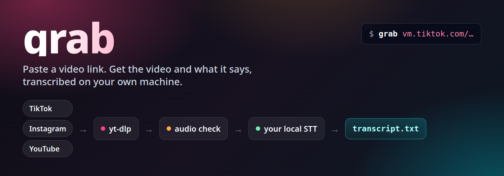

<p align="center">
  
</p>

# grab

`grab` downloads a video from TikTok, Instagram, YouTube or any of the other sites that
[yt-dlp](https://github.com/yt-dlp/yt-dlp) supports, and transcribes it with a speech-to-text
command that runs on your machine. No audio goes to a cloud service.

```console
$ grab --cookies-from-browser chrome https://vm.tiktok.com/<link>/
== https://vm.tiktok.com/<link>/
   audio track missing or cut short: downloading a format with its own audio
   transcript: grab_out/<creator>_<video-id>/transcript.txt (2170 words)
grab_out/<creator>_<video-id>
```

That run is an 11-minute TikTok. It shows the two problems `grab` handles for you:

1. **Broken audio from TikTok.** yt-dlp picks the best video format by default. On TikTok that
   is an H.265 stream with no sound, which yt-dlp joins with TikTok's separate audio stream. In
   this video that audio stream was 1.7 seconds long. `grab` measures the audio after every
   download, and when it is missing or shorter than 90% of the video, it downloads a format that
   has its own audio.
2. **Length limits in local models.** The model behind my STT command refuses audio longer than
   about 6.5 minutes. `grab` cuts the audio into 5-minute blocks (`--chunk` changes the length)
   and joins the text.

It also runs the latest yt-dlp release through `uvx` each time, because TikTok and Instagram
change often and an old yt-dlp stops working on them.

## Install

You need Python 3.8 or later, `ffmpeg` and `ffprobe`, and [`uv`](https://docs.astral.sh/uv/)
(or a `yt-dlp` on your `PATH`). `grab` uses the Python standard library only.

```bash
git clone https://github.com/hamen/video-grabber.git
ln -s "$PWD/video-grabber/grab" ~/.local/bin/grab
```

Then tell `grab` how to transcribe (next section), or use it with `--no-transcribe`.

## Connect your speech-to-text

`grab` calls one command for each audio block:

```
$GRAB_STT_CMD /path/to/block.wav
```

The file is a 16 kHz mono WAV. The command prints the text on stdout and exits 0. Anything that
works this way will do: a wrapper around whisper.cpp, faster-whisper, or a local STT server.
The default is `stt-file`, the name of the wrapper I use around the Nemotron server in
[speech-to-text-for-ubuntu](https://github.com/hamen/speech-to-text-for-ubuntu).

```bash
export GRAB_STT_CMD="my-stt --model small"   # parsed like a shell command line
```

## Use

```bash
grab URL [URL ...]                       # video + transcript
grab --cookies-from-browser chrome URL   # sites that want a login (TikTok, Instagram)
grab --no-video URL                      # keep only the transcript and the metadata
grab --no-transcribe URL                 # download only
grab -f urls.txt -o ~/videos             # one URL per line; # starts a comment
```

Each video gets a folder, `grab_out/<uploader>_<id>/`, with:

- `video.mp4` (or whatever format the site gave), unless you pass `--no-video`
- `video.info.json`, the yt-dlp metadata: title, description, uploader, duration, upload date
- `transcript.txt`, plain text, one line per audio block

On stdout, `grab` prints the folder of each finished video and nothing else, so you can pipe it.
Progress and errors go to stderr. The exit status is 1 if any URL failed.

`--cookies-from-browser` hands your browser's login for the site to yt-dlp. In November 2026
TikTok refused every download without it. Downloads then count against your account.

I tested `grab` on TikTok (short `vm.tiktok.com` links included) and YouTube. Instagram goes
through the same yt-dlp path, but I have not tested it yet.

## For AI agents

The agent instructions are in [`skills/grab/SKILL.md`](skills/grab/SKILL.md): when to use the
tool, how to read its output, and what to do for each error. Install it as a skill for Claude
Code and for the agents that read `~/.agents/skills` (Codex and others):

```bash
ln -s "$PWD/video-grabber/skills/grab" ~/.claude/skills/grab
ln -s "$PWD/video-grabber/skills/grab" ~/.agents/skills/grab
```

Link the directory, not the `SKILL.md` file: Codex skips a skill whose `SKILL.md` is a symlink.
Agents that change the code read [`AGENTS.md`](AGENTS.md).

## Develop

```bash
git config core.hooksPath .githooks   # once per clone: the pre-push hook runs bin/ci
bin/ci                                 # syntax, leak scan, tests
```

The tests use fake yt-dlp and STT commands in `tests/fakes/` and never touch the network. They
need `ffmpeg`, because they make real media files.

## License

MIT. See [LICENSE](LICENSE).
